 

  

  <strong>Software Developer & Tester</strong>
   
  <em>Building ideas into code.</em>

  
  
  

---

## About Me

Hi, I'm **Levi**, an aspiring software developer interested in building applications, exploring new technologies, and solving problems through code.

I enjoy both frontend and backend development, experimenting with different technologies, and continuously improving my skills through personal projects and practical experience.

- Currently studying software development
- Interested in full-stack development and software testing
- Enjoy building applications and exploring new ideas
- Focused on writing clean and maintainable code
- Always learning and looking for new challenges

---

## Tech Stack

### Languages

  
  
  
  
  
  
  
  

### Frameworks & Libraries

  
  

### Databases

  

### Tools

  
  
  
  

---

## GitHub Statistics

  
  

---

## Contribution Activity

  

  <picture>
    <source media="(prefers-color-scheme: dark)" srcset="https://raw.githubusercontent.com/hrvthlevi/hrvthlevi/output/snake-dark.svg">
    <source media="(prefers-color-scheme: light)" srcset="https://raw.githubusercontent.com/hrvthlevi/hrvthlevi/output/snake.svg">
    
  </picture>

---

  <em>Always learning. Always building.</em>
   
  Designed with curiosity. Built with code.

  ⭐️ From <a href="https://github.com/hrvthlevi">hrvthlevi</a>

